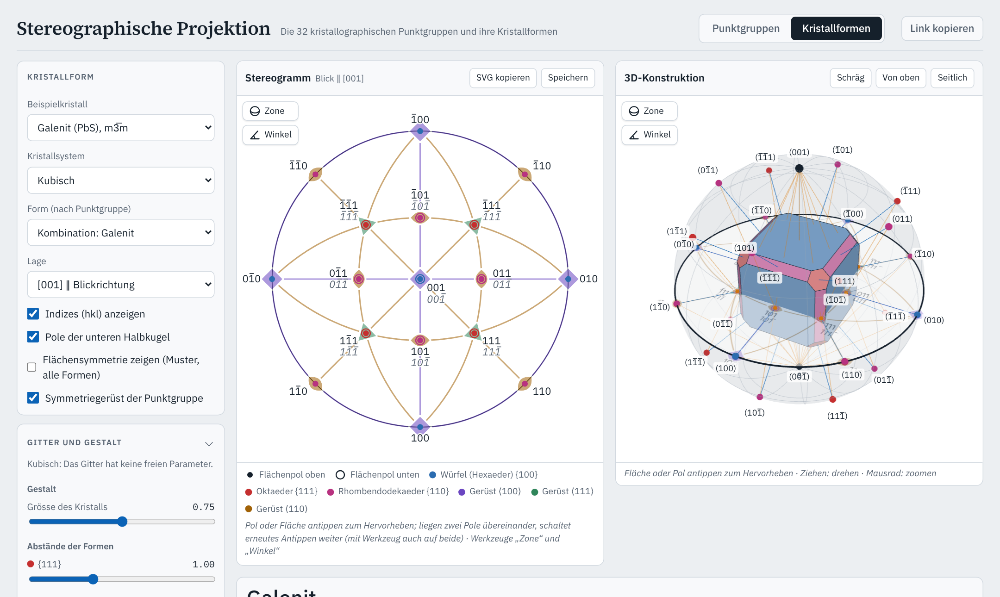

# Stereographische Projektion

[](https://github.com/manganite/stereography/actions/workflows/ci.yml)
[](https://github.com/manganite/stereography/actions/workflows/deploy.yml)
[](https://github.com/manganite/stereography/releases)
[](LICENSE)

Interaktive Lern-App für eine Einführung in die Kristallographie, entstanden aus der Vorlesung Kristallographie an der ETH Zürich: Stereogramme der 32 kristallographischen Punktgruppen und ihrer Kristallformen, gekoppelt mit einer 3D-Konstruktion, dazu ein Skript und ein Übungsquiz. Für Laptop, iPad und Telefon; läuft im Browser, als Web-App auf dem Homescreen und offline.

### [Zur App: manganite.github.io/stereography](https://manganite.github.io/stereography/)



## Funktionen

- **32 kristallographische Punktgruppen:** Stereogramme der Symmetriegerüste nach International Tables for Crystallography, Vol. A, inklusive der in ITA separat geführten Aufstellungen (monoklin Achse b/c, 321/312, 3m1/31m, 3̄m1/3̄1m, 4̄2m/4̄m2, 6̄m2/6̄2m).
- **Objekt in allgemeiner Lage:** Alle Symmetrieoperationen der Gruppe werden darauf angewendet (Pol im Stereogramm ziehbar; Antippen des Ausgangspols wechselt die Halbkugel). Punktgruppen mit zwei Aufstellungen erscheinen im Auswahlfeld als ein Button, die Aufstellung wird darunter gewählt.
- **Spezielle Lagen:** Nahe an einer Achse oder Spiegelebene rastet der Ausgangspol beim Ziehen ein. Die Infobox nennt die Lage des Ausgangspols mit Wyckoff-Lage und Lagesymmetrie nach ITA Tab. 10.1.2.2 (z. B. in m3̄m: allgemein 48*f*, auf einer Spiegelebene 24*d* m.. bzw. 24*e* ..m, auf [111] 8*b* .3m) und erklärt die Polzahl als Ordnung der Gruppe durch Ordnung der Lagesymmetrie. Zusammenfallende Pole werden einmal gezeichnet; fallen Bild und Spiegelbild zusammen, ist der Pol bei „Pole nach Händigkeit färben“ grau.
- **Kristallformen aller 32 Punktgruppen:** Auswahl nach Kristallsystem und Form, je Punktgruppe die allgemeine Form und die speziellen Grundformen nach ITA Tab. 10.1.2.2 (134 Formen, bei 32, 3m, 3̄m, 4̄2m und 6̄m2 in beiden Aufstellungen, z. B. 321 und 312; monoklin mit Achse b; Namen nach Borchardt-Ott & Sowa mit abweichenden ITA-Namen in Klammern, Eigensymmetrie nach Tab. 10.1.2.3), mit einblendbaren Indizes (hkl), bei hexagonalen Achsen wahlweise (hkil). Offene Formen werden durch Ergänzungsformen derselben Punktgruppe geschlossen (grau) oder wahlweise offen gezeigt. Optional liegt das Symmetriegerüst der Punktgruppe gedämpft unter den Polen. Ohne Flächensymmetrie (Standard) enthält die Auswahl je Punktgruppe die allgemeine Form und die Formen, deren Eigensymmetrie die Punktgruppe ist (78 Formen; z. B. Würfel nur unter m3̄m). Mit „Flächensymmetrie zeigen“ erscheinen alle 134 Formen, und die Flächen tragen ein Muster in allgemeiner Lage, das mit allen Operationen der Punktgruppe vervielfältigt ist; seine Anordnung zeigt die Flächensymmetrie (z. B. Würfel in 23: 2.., in m3̄m: 4m.m).
- **Zonen (Werkzeug „Zone“ am Stereogramm):** Zwei Pole antippen zeigt Zonenkreis (untere Hälfte gestrichelt), Zonenachse [uvw] = (h₁k₁l₁) × (h₂k₂l₂) mit ihrem Pol, alle Flächen der Zone nach der Zonengleichung hu + kv + lw = 0, den Winkel zwischen den Polen und in 3D die zur Zonenachse parallelen Kanten. Weicht die Richtung [uvw] von der Normalen (uvw) ab (in nicht kubischen Gittern möglich), wird die Abweichung angegeben. Die Infobox listet alle Zonen des Kristalls mit mindestens drei Flächen (Borchardt-Ott & Sowa), gruppiert nach symmetrisch gleichwertigen Zonenachsen ⟨uvw⟩; Zonen lassen sich gruppenweise oder einzeln wählen, auch mehrere zugleich, jede in eigener Farbe (Zonenkreis, Flächen, Pole). Zwei angetippte Pole fügen ihre Zone der Auswahl hinzu.
- **Skript** (`skript.html`): erklärt die stereographische Projektion mit Abbildungen aus dem Code der App; jede Abbildung öffnet mit einem Klick genau diese Ansicht in der App. Elf Kapitel: Kristallflächen und Indizes, Prinzip der Projektion, Symmetrieoperationen und Punktgruppen, Symmetriegerüste, Blickrichtungen, Kristallformen, Zonen, Tracht und Habitus, trigonale und hexagonale Kristalle, als Vertiefungen Lagen, Flächensymmetrie und Multiplizität sowie symmetrieändernde Verzerrungen; Begriffe nach Borchardt-Ott & Sowa, Quellen je Kapitel. Vertiefungen über den Grundstoff hinaus und Hinweise zur App sind eigens gekennzeichnet. Als PDF (A4) unter [skript.pdf](https://manganite.github.io/stereography/skript.pdf) und als Anhang jedes Releases; erzeugt mit `node tools/skript-pdf.mjs [Ausgabedatei]` (braucht Playwright mit Chromium).
- **Quiz** (`quiz.html`): Multiple-Choice-Fragen zu den Lernzielen des Skripts in drei Stufen (1 Grundlagen, 2 Anwendung, 3 Vertiefung; Stufe 3 bedeutet mehr Stoff, nicht unbedingt schwierigere Fragen), nach Kapitel wählbar, mit sofortiger Rückmeldung: Erklärung, Hinweis zur gewählten falschen Antwort, Link ins Skript und in die passende Ansicht der App. Am Ende jedes Skriptkapitels führt „Lernziele prüfen“ mit Kapitel und Stufe ins Quiz. Fragetypen: Einfach- und Mehrfachauswahl, Frage mit Bild, Bilder als Antworten, Bild mit Bildern als Antworten. Neben handgeschriebenen Fragen erzeugt das Quiz Fragen aus den Daten der App: Symmetriegerüst → Punktgruppe für alle 32 Punktgruppen, Flächenzahl und Flächensymmetrie, Bildzuordnungen Kristall ↔ Stereogramm, Lage ↔ Stereogramm und räumliches Symmetriegerüst ↔ Stereogramm mit festen räumlichen Zeichnungen. Höchstens die Hälfte eines Quiz sind erzeugte Fragen. Der Stand wird nur lokal im Browser gespeichert. Standardmässig erscheinen nur fachlich durchgesehene Fragen; der Schalter „Auch ungeprüfte Fragen zeigen“ auf der Startseite (oder `quiz.html?entwurf`) nimmt die übrigen dazu, gekennzeichnet mit „Entwurf“. Export für Moodle: `node tools/moodle-export.mjs quiz.xml` (Moodle-XML, Fragentyp Multiple Choice, Bilder als eingebettete SVG, Kategorien nach Kapitel und Stufe; mit `--entwurf` auch die ungeprüften Fragen).
- **Winkel (Werkzeug „Winkel“):** Zwei Pole oder Flächen antippen zeigt den Grosskreisbogen zwischen den Polen (im Stereogramm, auf der unteren Halbkugel gestrichelt, und auf der Umkugel in 3D), den Normalenwinkel n zwischen den Flächennormalen und den Flächenwinkel f = 180° − n (Begriffe nach Borchardt-Ott & Sowa).
- **Winkel im Punktgruppenmodus:** Mit dem Werkzeug „Winkel“ zwei Pole der allgemeinen Lage antippen; die Infobox nennt den Winkel und die Symmetrieoperation, die die beiden Pole ineinander überführt.
- **Tracht und Habitus** (Begriffe nach Borchardt-Ott & Sowa, Abschn. 5.2): Die Infobox nennt die auftretenden Formen und den Habitus-Grundtyp (isometrisch, planar oder taflig, prismatisch oder nadelig), bestimmt aus den Hauptausdehnungen L₁ ≥ L₂ ≥ L₃ des dargestellten Kristalls (zweite Momente des Körpers): isometrisch, wenn L₃/L₁ ≥ 2/3, sonst prismatisch oder planar.
- **Beispielkristalle:** Kombinationen mehrerer Formen derselben Punktgruppe aus Lehrbüchern (Galenit, Pyrit, zwei tetragonale Dipyramiden, Rutil, ein rhombisch-pyramidaler Kristall, Topas, Gips, ein triklin-pinakoidaler Kristall, Magnesium, Links- und Rechtsquarz, Turmalin), mit Quelle. Jede Form hat eine eigene Farbe; die Infobox listet die Tracht mit Flächenzahl und Eigensymmetrie. Gitter und Abstände der Formen lassen sich unter „Gitter und Gestalt“ ändern; die Abstände sind nach den Abbildungen gewählt, nicht gemessen.
- **Links auf Ansichten:** Der Zustand steht lesbar in der Adresse (z. B. `#m=pg&g=4/mmm&rho=40&az=30`); „Link kopieren“ kopiert sie, etwa für Folien. Ein Link hat Vorrang vor dem gespeicherten Zustand. Ein Blick der 3D-Konstruktion entlang einer Blickrichtung steht als `blick=1`, `2` oder `3` im Link (z. B. `#m=form&sys=tetragonal&f=4mm:a1&muster=1&blick=1&kugel=0&ns=0&ebene=0&strahlen=0&normalen=0&achsen=1&pole=0`: das Pedion in 4mm mit Flächenmuster von oben, ohne Hilfslinien); auf dem Telefon öffnet ein solcher Link die 3D-Tafel.
- **Verzerrung in zwei Stufen:** Standardmässig sind nur die Gitterparameter frei, die das Kristallsystem zulässt; die Symmetrie bleibt erhalten. Mit „Symmetrie brechen“ sind alle Parameter frei; die App bestimmt dann die verbleibende Punktgruppe und zeigt, in welche Formen die gewählte Form zerfällt (farbig).
- **Streckung entlang einer Blickrichtung:** Kristall und Gitter entlang einer Blickrichtung des Systems strecken oder stauchen, z. B. den Würfel entlang [111] zum Rhomboeder (m3̄m → 3̄m). Bei trigonaler Restgruppe eines kubischen Kristalls nennt die Infobox die hexagonalen Achsen und die Formen in hexagonalen Indizes.
- **Blickrichtungen:** Die Symmetrieelemente werden den Positionen des vollen Hermann-Mauguin-Symbols zugeordnet (Klassen äquivalenter Richtungen, z. B. in m3̄m ⟨100⟩, ⟨111⟩, ⟨110⟩) und auf Wunsch in deren Farbe gezeichnet, im Stereogramm, in der 3D-Ansicht, im vollen Symbol und in der nach Blickrichtungen gegliederten Liste der Infobox. In der 3D-Ansicht lassen sich einzelne Blickrichtungen ausblenden. Ohne Farben entspricht das Stereogramm der schwarzen ITA-Darstellung.
- **Hilfen für den Einstieg:** Karte „Erste Schritte“ beim ersten Besuch (über „?“ wieder zu öffnen), Tooltips am Laptop, ⓘ-Erklärungen je Abschnitt auf Touch-Geräten, Tooltip mit (hkl), ρ und φ über jedem Flächenpol. Selten gebrauchte Optionen liegen in zugeklappten Abschnitten.
- **3D-Konstruktion,** gekoppelt an das Stereogramm: Umkugel, Flächennormalen, Projektionsstrahlen zum Süd- bzw. Nordpol und das Stereogramm in der Äquatorebene.

## Nutzung

### Im Browser

Die App läuft in aktuellen Versionen von Safari, Chrome, Edge und Firefox: **https://manganite.github.io/stereography/**. Eine Installation ist nicht nötig. Einstellungen bleiben im Browser gespeichert; „Link kopieren“ erzeugt einen Link auf genau die aktuelle Ansicht, etwa für Folien.

### Als Web-App auf dem Homescreen

Die App lässt sich wie eine installierte App mit eigenem Symbol und ohne Browserleiste starten:

- **iPad und iPhone (Safari):** App öffnen, auf das Teilen-Symbol tippen (Quadrat mit Pfeil nach oben), dann **„Zum Home-Bildschirm“** und **„Hinzufügen“**.
- **Android (Chrome):** App öffnen, Menü **⋮** antippen, dann **„Zum Startbildschirm hinzufügen“** bzw. **„App installieren“**.
- **Laptop (Chrome oder Edge):** App öffnen, in der Adressleiste auf das Symbol **„App installieren“** klicken (Chrome) bzw. Menü **…** → **Apps** → **„Diese Website als App installieren“** (Edge).

### Offline

Nach dem ersten Aufruf hält ein Service Worker alle Dateien vor; die App funktioniert dann auch ohne Netz, im Browser wie auf dem Homescreen. Erscheint eine neue Version, lädt die App sie beim nächsten Öffnen mit Netz und startet einmal neu; Einstellungen bleiben erhalten.

### Lokal ausführen

Die App ist eine statische Webseite ohne Build-Schritt und ohne Abhängigkeiten.

1. Dateien holen: auf der [Release-Seite](https://github.com/manganite/stereography/releases/latest) unter „Assets“ **Source code (zip)** herunterladen und entpacken, oder
   ```bash
   git clone https://github.com/manganite/stereography.git
   ```
2. Im entpackten Ordner einen lokalen Webserver starten, zum Beispiel mit Python 3:
   ```bash
   cd stereography
   python3 -m http.server 8000
   ```
   (unter Windows `py -m http.server 8000`)
3. Im Browser **http://localhost:8000** öffnen.

Ein Doppelklick auf `index.html` genügt nicht: Browser laden die JavaScript-Module der App nicht von `file://`-Adressen.

## Konventionen

- Blick entlang c (bzw. entlang der gewählten Richtung), a zeigt nach unten, b nach rechts (ITA).
- Winkelkoordinaten wie bei Borchardt-Ott & Sowa (Abschn. 5.5–5.7, Tab. 5.1): Azimut φ ab dem rechten Rand (→, bei orthogonalen Achsen b) im Uhrzeigersinn, so dass (100) bei 90° liegt; Poldistanz ρ auf der oberen Halbkugel vom Nordpol (Zentrum), auf der unteren vom Südpol mit negativem Vorzeichen (−90° … 0°). Links aus v1.0.0 mit `phi=` (alte Zählung ab ↓ im Gegenuhrzeigersinn) werden umgerechnet; `rho=` über 90° (alte Zählung vom Nordpol) gilt weiter.
- Pole oberhalb der Projektionsebene: Punkt; unterhalb: Kreis; beide an derselben Stelle: Kreis mit Punkt.
- Spiegelebenen als kräftige Linien; Spiegelebene senkrecht zur Projektionsrichtung als kräftiger Grundkreis.
- Symbole und ihre Lage nach ITA A (2006), Kap. 1.4.5 und Tab. 10.1.2.2: Linsen tangential (Achse ⊥ Projektionsebene: ∥ a), Quadrat auf der Spitze, Dreieck mit Spitze nach oben bzw. bei geneigten Achsen radial nach aussen, 4̄ als offenes Quadrat mit Linse zwischen zwei Ecken, 6̄ als offenes Sechseck mit einbeschriebenem Dreieck. Der Punkt für das Inversionszentrum (2/m, 4/m, 6/m) erscheint nur an der Achse senkrecht zur Projektionsebene.
- Dünne Linien für Symmetrieachsen in der Projektionsebene sowie, im kubischen System, für die Zonen {100} und {110}, soweit sie keine Spiegelebenen sind.
- Hexagonale und trigonale Formen mit hexagonalen Achsen. Standard sind drei Indizes (hkl); Miller-Bravais-Indizes (hkil) mit i = −(h+k) lassen sich zuschalten.

## Entwicklung

### Aufbau

| Datei | Inhalt |
|---|---|
| `index.html` | Oberfläche der App und Gestaltung, soweit sie nur diese App betrifft |
| `skript.html`, `js/skript.js` | Skript; Abbildungen über `js/scene.js` aus Link-Adressen der App |
| `quiz.html`, `js/quiz.js` | Quiz: Fragen, Kapitel (`js/quiz-kapitel.js`) und Bilder dieser App; Ablauf aus `lib/common/` |
| `js/quiz-bank.js`, `js/quiz-gen.js` | Handgeschriebene Fragen (mit Quelle und Prüfstatus) und Generatoren für erzeugte Fragen |
| `js/bild3d.js` | Feste räumliche Zeichnungen (SVG) von Kristallen und Symmetriegerüsten für Quiz und Moodle-Export |
| `tools/moodle-export.mjs` | Export der geprüften Fragen als Moodle-XML |
| `js/pointgroups.js` | Generatoren der Punktgruppen, Gruppenerzeugung, automatische Bestimmung der Symmetrieelemente |
| `js/forms.js` | Formenkatalog nach ITA Tab. 10.1.2.2/10.1.2.3 |
| `js/sitesym.js` | Lage eines Pols: Einrasten, Lagesymmetrie, Multiplizität, Wyckoff-Lage |
| `js/examples.js` | Beispielkristalle (Formen, Gitter, Abstände, Quellen) |
| `js/polyhedra.js` | Gitter aller Systeme, Flächenbahnen, Ergänzungsformen, Restsymmetrie, Halbraumschnitt, Lagen |
| `js/stereogram.js` | SVG-Stereogramm mit ITA-Symbolen und Wulffschem Netz |
| `js/view3d.js` | 3D-Ansicht (three.js) |
| `js/scene.js` | Zustand, Link-Adresse und Szenen des Stereogramms (gemeinsam für App, Skript und Quiz) |
| `js/main.js` | Bedienung der App |
| `js/hilfetexte.js` | Texte der Tooltips und ⓘ-Erklärungen |
| `js/version.js` | Versionsnummer der App |
| `sw.js` | Service Worker für den Offline-Betrieb |
| `tests/` | Automatische Tests (Node, ohne Abhängigkeiten) |
| `js/linalg.js` | Vektoren und Matrizen |
| `manifest.webmanifest`, `icons/` | Favicon und Homescreen-Icons (iPad/iPhone: Teilen → Zum Home-Bildschirm; Android: Menü → Zum Startbildschirm hinzufügen) |
| `lib/common/`, `tools/common/` | Gemeinsame Grundlage der App-Familie aus [crystallography-common](https://github.com/manganite/crystallography-common), als Kopie mit fester Version (`lib/common/MANIFEST.json`): Stile (`base.css`, `app.css`, `skript.css`, `quiz.css`), Schriften, Hilfen, Quiz, Skript-Bausteine, Formatierung, Werkzeuge. Nicht von Hand ändern; siehe unten. |
| `lib/common/fonts/` | Schriften IBM Plex Sans, IBM Plex Mono und Source Serif 4 (WOFF2, nur benötigte Schnitte, aus den npm-Paketen `@fontsource/*`), SIL Open Font License 1.1, siehe `lib/common/fonts/LICENSE-*.txt`. Selbst gehostet, damit die App ohne Verbindung zu Google auskommt. |
| `lib/three.bundle.js` | three.js r186 mit OrbitControls und CSS2DRenderer (MIT-Lizenz, siehe `lib/three-LICENSE.txt`) |

Die Flächenzahl jeder Katalogform wird beim Erzeugen mit der Multiplizität aus ITA verglichen (alle 134 stimmen überein); ebenso die Flächensymmetrie jeder Form mit dem berechneten Stabilisator der Fläche. Die Symmetrieelemente werden nicht von Hand eingetragen, sondern aus den Gruppenelementen berechnet (Drehachsen aus Spur und Eigenvektor, Spiegelebenen und Drehinversionsachsen aus −R).

### Gemeinsame Grundlage

Die App gehört zu einer Familie von Lern-Apps mit gleichem Aussehen, gleicher Bedienung und gleich aufgebautem Skript und Quiz. Was sich teilen lässt, liegt in [crystallography-common](https://github.com/manganite/crystallography-common), dort steht auch der [Leitfaden](https://github.com/manganite/crystallography-common/blob/main/LEITFADEN.md). Die App enthält davon eine Kopie mit fester Version; eine neue Version übernimmt man von einem Release-Tag:

```bash
node tools/common/sync.mjs ../crystallography-common
```

`tests/common.test.mjs` prüft, dass die Kopie dem Manifest entspricht. Änderungen an gemeinsamen Dateien gehören nach crystallography-common, nicht in die Kopie.

### Tests

```bash
node --test tests/*.test.mjs
```

Geprüft werden die Gruppenordnungen aller 40 Punktgruppen-Einträge, die Zuordnung der Symmetrieelemente zu den Blickrichtungen, die Flächenzahl aller 134 Formen gegen ITA, geschlossene Polyeder (Euler-Charakteristik 2), die Beispielkristalle, Lagen und Streckungen, die Abbildungen des Skripts und die Kennzeichnung der Vertiefungen, die Quizfragen (Pflichtfelder, Lernziel wörtlich im Skript, nachgerechnete Antworten, verschiedene Antwortbilder, Höchstanteile beim Ziehen, Moodle-Export) sowie die Release-Konsistenz (Version, Changelog, Offline-Liste) und die Kopie der gemeinsamen Dateien. Dieselben Tests laufen bei jedem Pull Request in GitHub Actions.

### Versionen und Releases

Die App folgt [Semantic Versioning](https://semver.org/lang/de/); Änderungen stehen im [CHANGELOG](CHANGELOG.md). Änderungen gehen über einen Branch und einen Pull Request nach `main`. Die Live-Seite wird nur bei einem Release aktualisiert:

1. Version in `js/version.js`, `sw.js` und `CITATION.cff` (mit `date-released`) erhöhen (neue Funktion: zweite Stelle, Korrektur: dritte Stelle).
2. Einträge unter `## [Unreleased]` in `CHANGELOG.md` unter eine neue Überschrift `## [x.y.z] - JJJJ-MM-TT` verschieben, Links am Ende ergänzen.
3. Auf `main` taggen und pushen: `git tag -a vX.Y.Z -m "vX.Y.Z" && git push origin vX.Y.Z`.

Der Tag startet zwei Workflows: `release.yml` legt das GitHub-Release mit den Notizen aus dem Changelog an, `deploy.yml` prüft und veröffentlicht den Stand auf GitHub Pages. Beide erzeugen dabei die PDF-Fassung des Skripts (`tools/skript-pdf.mjs`): auf der Seite als `skript.pdf`, im Release als Anhang.

## Grundlagen und Quellen

- International Tables for Crystallography, Vol. A (2006), Kap. 1.4.5 und Tab. 10.1.2.2/10.1.2.3: Symbole, Formen, Eigensymmetrie.
- W. Borchardt-Ott, H. Sowa: *Kristallographie. Eine Einführung für Studierende der Naturwissenschaften*, Springer, Berlin 2018, [doi:10.1007/978-3-662-56816-3](https://doi.org/10.1007/978-3-662-56816-3): Begriffe (Tracht, Habitus, Flächensymmetrie, erzeugende Symmetrie und Eigensymmetrie, Normalen- und Flächenwinkel, Zonengleichung), Namen der Kristallformen, Winkelkoordinaten φ und ρ, Beispielkristalle.
- F. Hoffmann: *Faszination Kristalle und Symmetrie. Einführung in die Kristallographie*, Springer Fachmedien, Wiesbaden 2016, [doi:10.1007/978-3-658-09581-9](https://doi.org/10.1007/978-3-658-09581-9): Beispielkristalle.

Die Quelle jedes Beispielkristalls steht in der App und in `js/examples.js`.

## Zitieren

Wer die App in Lehre oder Publikationen nennt, findet die Angaben in [`CITATION.cff`](CITATION.cff) bzw. auf GitHub unter „Cite this repository“.

## Lizenz

Die App steht unter der MIT-Lizenz (`LICENSE`). Die mitgelieferte Bibliothek three.js steht ebenfalls unter der MIT-Lizenz, mit eigenem Copyright-Vermerk der three.js-Autoren in `lib/three-LICENSE.txt`. Dieser Vermerk muss nach den Lizenzbedingungen mit der Bibliothek weitergegeben werden. Die Schriften in `lib/common/fonts/` stehen unter der SIL Open Font License 1.1 (Lizenztexte liegen bei).
